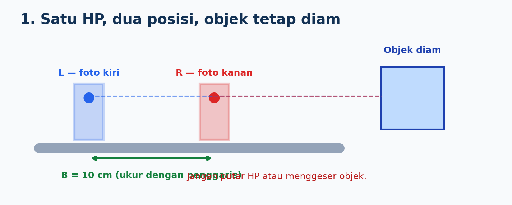
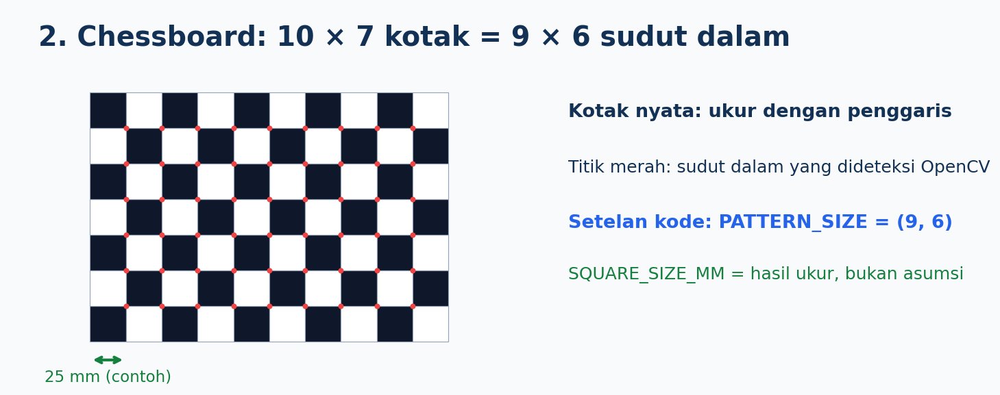
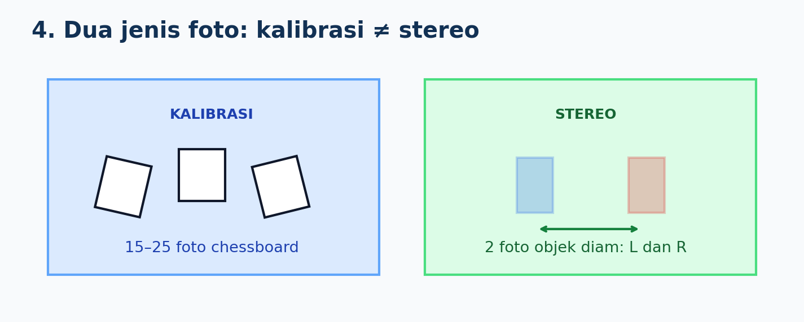
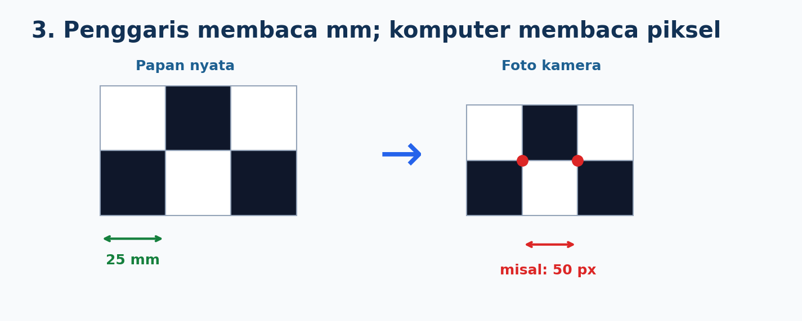
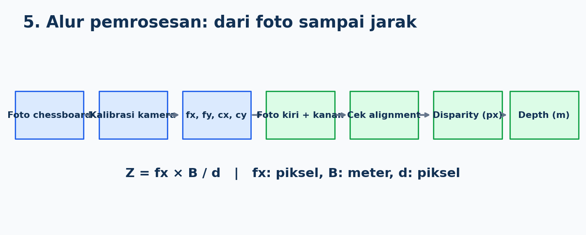

# Praktikum Stereo Vision — 1 HP Digeser

**Target:** kalibrasi kamera HP untuk mendapatkan `fx`, mengambil dua foto objek diam, menghitung *disparity*, lalu mengukur *depth* (jarak arah depan kamera).

**Buka kode:** [`Starter_Stereo_1HP.ipynb`](Starter_Stereo_1HP.ipynb). README ini berisi **apa yang dilakukan dan apa yang dicatat**. Notebook berisi kode yang dijalankan.



## 1. Siapkan alat

- Satu HP (gunakan **kamera utama yang sama** dari awal sampai akhir).
- Rel/alas lurus, dudukan HP, penggaris dan meteran.
- Papan chessboard tercetak **10 × 7 kotak**, rata dan tidak melengkung.
- Objek diam dan bertekstur (contoh: buku dengan gambar, kotak bermotif).
- Laptop dengan Jupyter atau Google Colab; Python dan OpenCV.

**Aturan kamera:** gunakan resolusi dan orientasi foto yang sama; jangan memakai zoom digital, mode potret, filter, atau mengganti lensa. Kunci fokus/eksposur bila memungkinkan. Pengaturan kamera jangan berubah setelah kalibrasi. Untuk uji awal, pilih objek diam dan cahaya terang.

## 2. Ukur chessboard



1. Cetak chessboard **10 kotak mendatar × 7 kotak tegak**.
2. Tempel rata di karton/papan.
3. Ukur **sisi satu kotak** dengan penggaris. Contoh: **25 mm**; gunakan hasil ukur sebenarnya.
4. Ingat: 10 × 7 **kotak** menghasilkan **9 × 6 sudut dalam** yang dibaca OpenCV.

**Catat:** `SQUARE_SIZE_MM = ___ mm` dan `PATTERN_SIZE = (9, 6)`.

## 3. Ambil foto untuk kalibrasi (`calibration/`)



1. Ambil **15–25 foto chessboard** dengan kamera HP tersebut.
2. Variasikan posisi papan di foto: tengah, tepi, miring, dekat, dan agak jauh.
3. Seluruh sudut bagian dalam harus terlihat dan tajam; jangan blur.
4. Beri nama `cal_01.jpg`, `cal_02.jpg`, dan seterusnya.

**Catat:** jumlah foto yang diambil: `___` foto. Jangan mencatat `fx` dulu: nilainya baru muncul setelah kode kalibrasi dijalankan.

## 4. Ambil dua foto stereo (`stereo/`)


1. Pasang HP pada rel lurus; tandai **L** dan **R**.
2. Ukur pergeseran **pusat kamera** dari L ke R dengan penggaris. Contoh: **10 cm**.
3. Foto objek diam dari L → simpan `left.jpg`.
4. **Geser ke kanan**, jangan memutar atau memiringkan HP → foto dari R → simpan `right.jpg`.
5. Jangan menggerakkan objek atau latar. Pastikan kedua foto punya ukuran piksel sama.

**Catat:** `BASELINE_CM = ___ cm`; jarak objek menurut meteran `Z_true = ___ m` (ukur kedalaman searah kamera); dokumentasikan foto posisi L dan R.

> Jangan campurkan foto kalibrasi dan foto stereo. Foto kalibrasi berisi papan chessboard; foto stereo berisi objek yang akan diukur.

## 5. Susun file dan jalankan notebook

```text
praktikum_stereo/
├── calibration/
│   ├── cal_01.jpg
│   ├── cal_02.jpg
│   └── ...
├── stereo/
│   ├── left.jpg
│   └── right.jpg
└── output/       # dibuat otomatis oleh notebook
```

**Jupyter lokal:** letakkan folder `praktikum_stereo` di samping notebook.
**Google Colab:** ZIP folder `praktikum_stereo`, lalu jalankan sel unggah ZIP di notebook.

Jalankan sel notebook **berurutan dari A sampai G**:

| Sel | Yang dilakukan kode | Apa yang dicatat |
|---|---|---|
| **A** | Konfigurasi, baca folder | Ukuran kotak (mm), baseline (cm), jumlah foto |
| **B** | Deteksi sudut chessboard | Foto berhasil/gagal, jarak dua sudut (px) |
| **C** | Kalibrasi dengan `calibrateCamera()` | **fx, fy, cx, cy**, RMS error, gambar corner |
| **D** | Baca kiri/kanan, koreksi distorsi, cek alignment | Median selisih vertikal `dy` (px), status cek |
| **E** | Hitung disparity dan depth map | Tampilan disparity/depth, persentase piksel valid |
| **F** | Ukur objek pada ROI, bandingkan meteran | Disparity median, `Z_est`, `Z_true`, error (%) |
| **G** | Simpan data percobaan | File CSV dan gambar hasil |

### Cara komputer tahu ukuran kotak dalam piksel



- Penggaris memberi jarak **nyata** antar-sudut, misalnya **25 mm**.
- OpenCV mendeteksi koordinat sudut pada foto, misalnya `(320,240)` dan `(370,240)`.
- Selisihnya **50 piksel** pada foto **tersebut**. Di foto lain bisa berbeda karena sudut/jarak papan berbeda.
- `calibrateCamera()` memakai **semua sudut di banyak foto** untuk menghitung `fx`, `fy`, `cx`, `cy`, dan distorsi. **Tidak perlu mengukur jarak kamera–papan dengan meteran untuk kalibrasi OpenCV.**

**`fx`, `fy`** = panjang fokus efektif pada arah horizontal/vertikal dalam piksel. **`cx`, `cy`** = koordinat titik pusat proyeksi (*principal point*) dalam gambar, juga dalam piksel. Jangan mengisi `fx=800` sebagai hasil: nilai harus berasal dari **hasil kalibrasi HP sendiri**.

## 6. Cek hasil sebelum menyimpulkan jarak



- **Kalibrasi:** banyak sudut terdeteksi dan RMS cukup kecil; RMS adalah indikator, bukan jaminan akurasi depth.
- **Alignment:** titik yang cocok pada foto L/R seharusnya hampir berada pada baris yang sama. Jika notebook menghentikan proses, ulang pengambilan foto stereo dengan posisi lebih stabil.
- **Depth:** rumus pendekatan `Z = fx × B / d` hanya dipakai bila dua foto mendekati pasangan stereo sejajar. **Kalibrasi satu kamera tidak otomatis melakukan stereo rectification.** Hasil dengan HP digeser manual adalah perkiraan dan perlu diverifikasi.
- Piksel pada area polos, bayangan, refleksi, atau tepi bisa memiliki disparity tidak valid.

## 7. Uji tiga jarak dan isi tabel

Ulangi foto `left.jpg` dan `right.jpg` untuk **setiap** jarak objek. Kalibrasi boleh dipakai ulang selama pengaturan kamera tetap sama. Catat satu baris dari output sel G pada setiap percobaan.

| Uji | Jarak meteran (m) | Baseline (cm) | fx (px) | Disparity ROI (px) | Depth estimasi (m) | Error (%) |
|---|---:|---:|---:|---:|---:|---:|
| 1 | 0,50 | | | | | |
| 2 | 1,00 | | | | | |
| 3 | 1,50 | | | | | |

Rumus: `Error (%) = abs(Z_est - Z_true) / Z_true × 100`. Jika disparity tidak valid, tulis **"gagal"**, bukan mengarang angka.

## 8. Yang dikumpulkan

1. Folder foto `calibration/` (15–25 foto) dan `stereo/` (minimal tiga pasang untuk tiga jarak; beri nama per percobaan ketika mengumpulkan).
2. Notebook `.ipynb` **yang sudah dijalankan**, dengan hasil kalibrasi, visualisasi disparity dan depth, serta tabel pengukuran.
3. Tabel tiga pengukuran dan **analisis singkat**: mengapa hasil berbeda dari meteran? apa pengaruh tekstur, baseline, dan kemiringan HP?
4. **Dua flowchart buatan mahasiswa**: (a) kalibrasi `foto → deteksi corner → cek jumlah → calibrateCamera → simpan parameter`; (b) `foto L/R → undistort → cek alignment → disparity → depth → ROI → error`. Cantumkan **percabangan saat foto gagal terdeteksi atau alignment gagal**.

**Selesai jika:** Anda dapat menunjukkan nilai `fx` hasil kalibrasi HP, screenshot disparity/depth, dan tiga hasil jarak atau penjelasan teknis yang terukur tentang kegagalannya.
